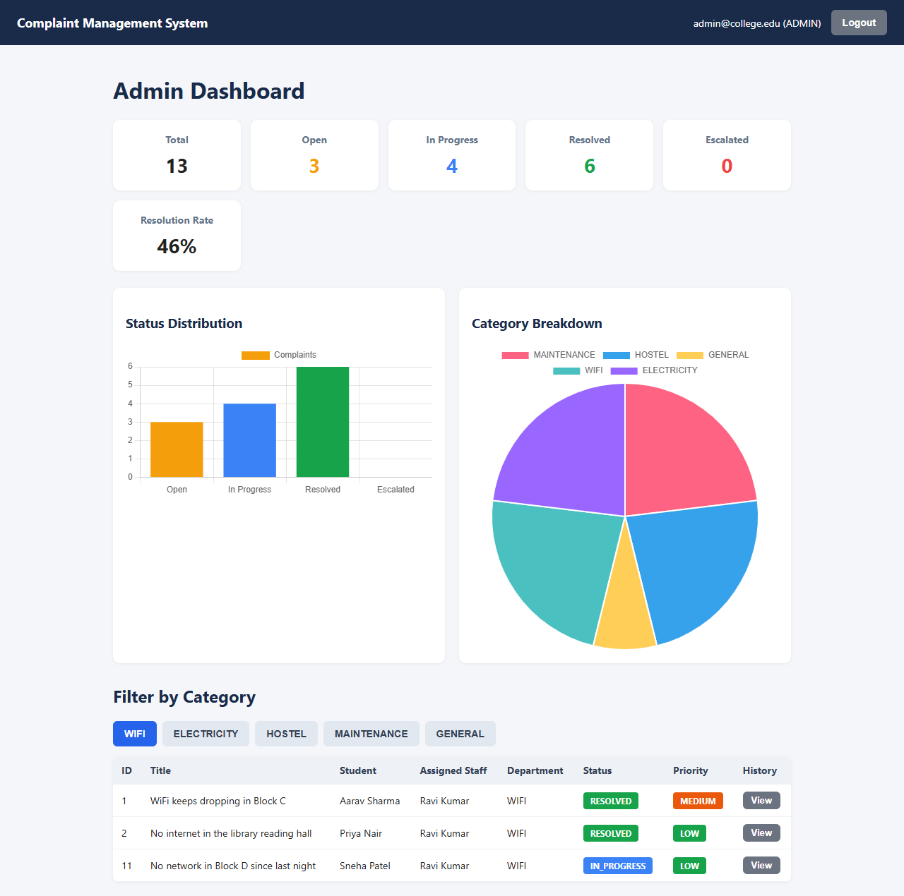
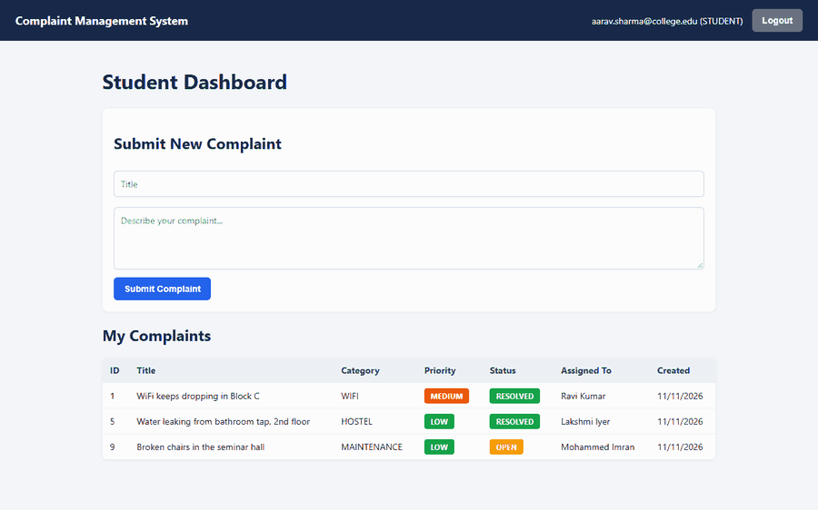
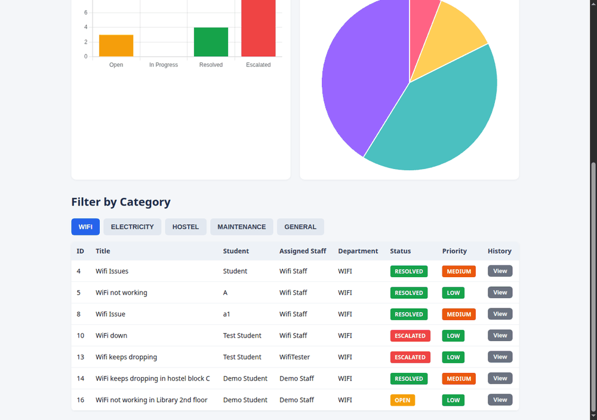
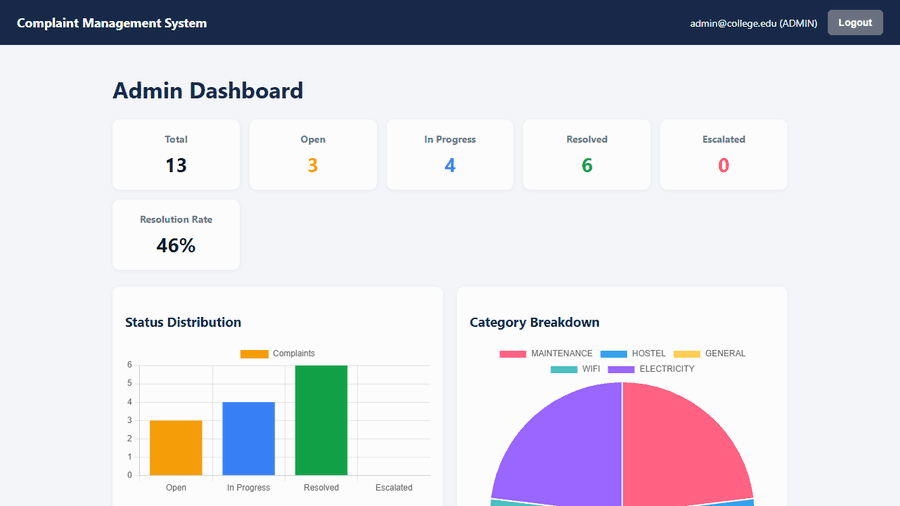
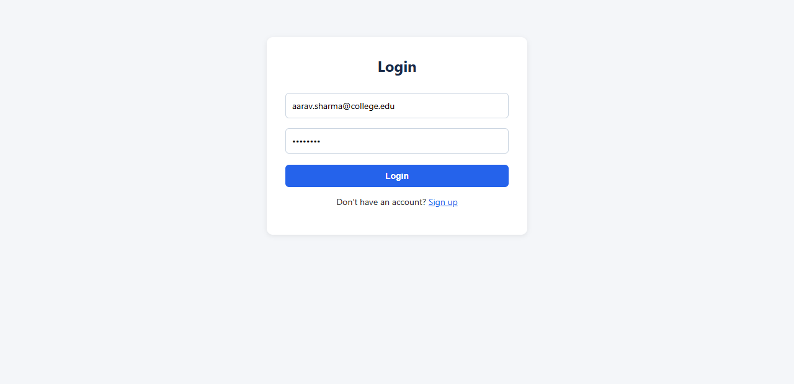
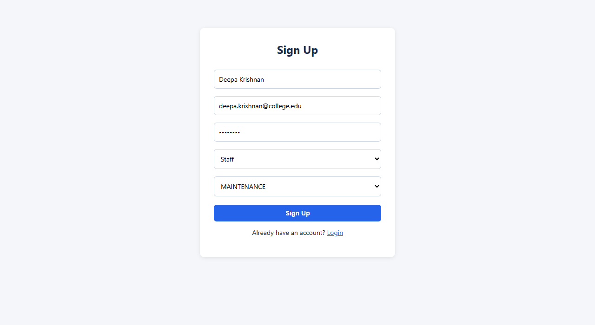

# Complaint Management System

A complaint portal for a college campus. Students file complaints, the backend
classifies each one into a category and priority (Google Gemini, with a keyword
fallback) and assigns it to a staff member in the matching department. Staff move
complaints through a status lifecycle, old ones get escalated automatically, and
admins get a dashboard with charts and a per-complaint status history.

Stack: React 19 + Vite on the frontend, Spring Boot 3 (Java 17) + MySQL on the
backend, JWT for auth. `build.sh` bundles the React build into the Spring Boot
JAR so the whole app runs as one process on port 8080.



## Screenshots

| Student submitting a complaint | Admin viewing a complaint's status history |
|---|---|
|  |  |

Admin filtering complaints by category:



<p align="center">
  
  &nbsp;
  
</p>

## Features

- **Three roles.** Student, Staff and Admin, each with its own dashboard. Login
  returns a JWT that carries the user's email and role, and every API route is
  restricted to one role in Spring Security. Passwords are hashed with BCrypt.
- **Classification.** On submit, the complaint text is sent to Gemini, which picks
  one of 4 categories (WiFi, Electricity, Hostel, Maintenance) and a priority
  (Low, Medium, High). If the call fails or no API key is set, keyword rules pick
  them instead, and anything that matches no keywords goes to a fifth category,
  General. The Gemini call has a 4 s connect / 8 s read timeout, so a slow API
  can't hold up a submission for long before the fallback takes over.
- **Assignment.** A complaint goes to the staff member in the matching department
  with the fewest unresolved complaints. General complaints stay unassigned.
- **Status lifecycle.** `OPEN → IN_PROGRESS → RESOLVED`, plus
  `ESCALATED → IN_PROGRESS` and `RESOLVED → OPEN` (reopen; the API allows it but
  the UI has no button for it yet). Other moves are rejected with a 400.
- **Escalation.** A `@Scheduled` job runs every hour and marks any OPEN or
  IN_PROGRESS complaint older than 48 hours as ESCALATED (set `ESCALATION_HOURS`
  to change it).
- **History.** Every status change, whether by staff or the escalation job, is
  saved to a `complaint_history` table. Admins can view it as a timeline.
- **Admin dashboard.** Counts by status, a status bar chart, a category pie chart,
  the resolution rate, and a table filtered by category.

## How it fits together

```
Browser (React SPA) --> Spring Boot :8080 --> MySQL
                              |
                              +--> Gemini API (keyword fallback if it fails)
```

The database has 8 JPA entities: `User`, `Role`, `Department`, `Complaint`,
`Category`, `Priority`, `Status` and `ComplaintHistory`. Hibernate creates the
tables (`ddl-auto=update`), and `DataSeeder` fills the lookup tables (roles,
departments, categories, priorities, statuses) on first startup.

Auth is handled by Spring Security. `JwtAuthFilter` reads the token from the
`Authorization` header and sets the user's role, and `SecurityConfig` maps each
route to the role allowed to call it. A missing or invalid token gets a 401, the
wrong role gets a 403.

### API

| Method | Path | Role |
|---|---|---|
| POST | `/api/auth/signup` | anyone (student or staff only) |
| POST | `/api/auth/login` | anyone (returns the JWT) |
| POST | `/api/complaints` | student |
| GET | `/api/complaints/my` | student |
| GET | `/api/complaints/assigned` | staff |
| PUT | `/api/complaints/status?id=&status=` | staff (assigned complaints only) |
| GET | `/api/complaints` | admin |
| GET | `/api/complaints/category/{category}` | admin |
| GET | `/api/complaints/categories/summary` | admin |
| GET | `/api/complaints/analytics` | admin |
| GET | `/api/complaints/{id}/history` | admin |

Errors come back as `{ "status": 400, "error": "Wrong password" }`.

## Running it locally

You need Java 17 or newer, Node 20.19+ (Vite 8 requirement) and a running MySQL
server with an empty database:

```sql
CREATE DATABASE complaint_system;
```

The backend reads these environment variables (see
`backend/src/main/resources/application.properties`):

| Variable | Default |
|---|---|
| `JWT_SECRET` | none, **required**. At least 32 characters |
| `ADMIN_EMAIL`, `ADMIN_PASSWORD` | none. If set, this admin account is created on startup |
| `DB_URL` | `jdbc:mysql://localhost:3306/complaint_system` |
| `DB_USERNAME`, `DB_PASSWORD` | `root` / empty |
| `ESCALATION_HOURS` | `48` |
| `JWT_EXPIRATION` | `86400000` (24 h, in ms) |
| `GEMINI_API_KEY` | empty. Optional; without it the keyword rules are used |

For example, in Git Bash:

```bash
export JWT_SECRET="$(openssl rand -hex 32)"
export DB_PASSWORD="your-mysql-password"
export ADMIN_EMAIL="admin@college.edu" ADMIN_PASSWORD="choose-a-password"
```

### Single JAR

```bash
./build.sh
java -jar backend/target/complaint-system-0.0.1-SNAPSHOT.jar
```

Open http://localhost:8080. On Windows, run `build.sh` from Git Bash.

### Separate dev servers (hot reload)

```bash
# terminal 1: backend on :8080
cd backend && ./mvnw spring-boot:run

# terminal 2: frontend on :5173, proxies /api to :8080
cd frontend && npm install && npm run dev
```

Open http://localhost:5173.

### Accounts

The admin account comes from `ADMIN_EMAIL` / `ADMIN_PASSWORD` and is created on
the first startup where they are set. Admins can't sign up through the app or the
API. Create students and staff on the Sign Up page; staff pick a department, and
only staff in a department get complaints for it.

## Known limitations

- Anyone can sign up as staff. A real deployment would want staff accounts
  approved by an admin.
- The Gemini call is synchronous, so a slow API can delay a submission by up to
  the 12 s of timeouts before the keyword fallback runs.
- The submit result is shown in a browser `alert()`.
- The only test is the default Spring context-load test, and it needs a running
  MySQL.

## Project layout

```
frontend/   React + Vite app (pages/, components/, services/ for API calls)
backend/    Spring Boot API; also serves the built frontend from static/
docs/       screenshots and GIFs used in this README
build.sh    builds the frontend, copies it into the backend, packages the JAR
```
